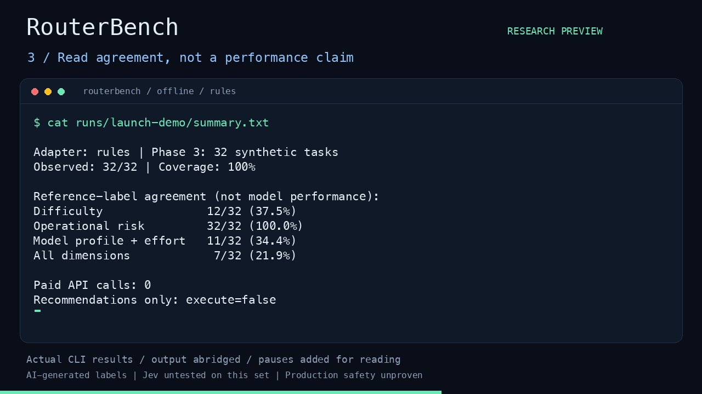

# 39-second offline terminal demo

[Watch or download the MP4](https://github.com/omersuve/routerbench/blob/main/docs/media/routerbench-demo.mp4)
· [Terminal playback file](https://github.com/omersuve/routerbench/blob/main/docs/media/routerbench-demo.cast)
· [Plain-text transcript](media/routerbench-demo.txt)

[](https://github.com/omersuve/routerbench/blob/main/docs/media/routerbench-demo.mp4)

The demo uses an actual invocation of the existing CLI on the 32 phase 3 synthetic
tasks. It runs the deterministic **rules** adapter, not a model or provider replay.
No API key, paid call, local model or extra runtime dependency is needed.

This is paced playback of the saved CLI output, with selected JSON fields shown
and a summary generated from `score.json`. Reading pauses make it 39 seconds;
the video is **not a latency measurement**. The MP4 is silent, 1280×720, H.264.

## Reproduce the run

From the repository root, use a new output name if `runs/launch-demo` already exists:

```sh
python3 -m routerbench predict --inputs datasets/phase3/inputs.json --adapter rules --output runs/launch-demo
python3 -m routerbench score --run runs/launch-demo --labels datasets/phase3/labels.json --output runs/launch-demo/score.json
```

The demo's compact summary is derived from that saved report:

```sh
python3 - <<'PY'
import json
from pathlib import Path

s = json.loads(Path('runs/launch-demo/score.json').read_text())
lines = [
    f'Adapter: {s["adapter"]} | Phase 3: {s["n"]} synthetic tasks',
    f'Observed: {s["observed"]}/{s["n"]} | Coverage: {s["coverage"]:.0%}',
    '', 'Reference-label agreement (not model performance):',
]
for key, title in [('difficulty', 'Difficulty'), ('risk', 'Operational risk'),
                   ('route_exact', 'Model profile + effort'), ('all_exact', 'All dimensions')]:
    m = s['metrics'][key]
    lines.append(f'{title:24} {m["correct"]:2}/{m["total"]} ({m["accuracy"]:.1%})')
lines += ['', f'Paid API calls: {s["paid_calls_this_run"]}', 'Recommendations only: execute=false']
with Path('runs/launch-demo/summary.txt').open('x') as out:
    out.write('\n'.join(lines) + '\n')
PY
cat runs/launch-demo/summary.txt
```

## What the run shows

| Measure | Rules |
|---|---:|
| Observed / coverage | 32/32 / 100% |
| Difficulty agreement | 12/32 (37.5%) |
| Operational-risk agreement | 32/32 (100%) |
| Model profile + effort agreement | 11/32 (34.4%) |
| All dimensions agree | 7/32 (21.9%) |
| Paid API calls | 0 |

These counts match the existing phase 3 rules summary. Timing varies between
runs and is omitted from the video. Predictions are hash-sealed before labels
are loaded by the scorer; recommendations remain `execute=false`.

**The labels are AI-generated, without independent human adjudication. Jev was
not measured on this 32-task set. Production safety is unproven.** Profiles are
hypothetical; agreement is not proof of actual model quality or optimal routing.
See the [methodology](methodology.md) and [recorded aggregate results](../results/summary.json).
